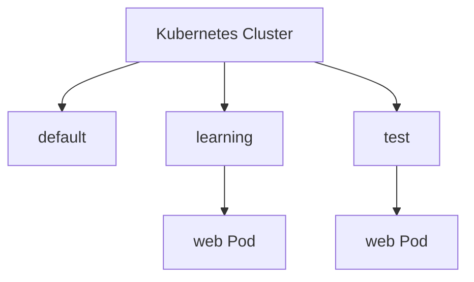
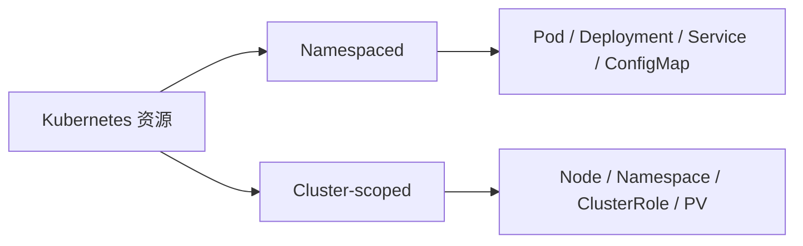

# 02｜Namespace：给资源划分实验空间

[← 上一章](01-cluster-start-and-architecture.md) · [首页](../README.md) · [下一章：Pod →](03-pod.md)

## 概念

Namespace 像同一栋大楼中的不同楼层。不同团队或环境可以使用相同资源名，但彼此隔离。



## 创建学习 Namespace

```powershell
kubectl create namespace learning
kubectl get namespaces
```

设置当前上下文默认 Namespace：

```powershell
kubectl config set-context --current --namespace=learning
kubectl config view --minify | Select-String namespace
```

也可以通过 YAML：

```yaml
apiVersion: v1
kind: Namespace
metadata:
  name: learning
```

## 验证

```powershell
kubectl get all
kubectl get all -n learning
kubectl get all -n default
```

Dashboard 中从顶部 Namespace 下拉框选择 `learning`。

## 重要提醒

并非所有资源都属于 Namespace：



## 本章验收

```powershell
kubectl config view --minify -o jsonpath='{..namespace}'
```

输出 `learning` 即完成。


## 生命周期补充：清理与第二次创建

> 本章与后续章节共享 `learning` Namespace。**只能在确认里面没有需要保留的其他实验资源时执行以下删除**，不要在学习途中随意删除。

```powershell
kubectl config current-context
kubectl get all,configmaps,secrets,pvc,ingress,networkpolicy,serviceaccounts,roles,rolebindings -n learning
# 确认没有需要保留的数据后，再手动运行：
kubectl delete namespace learning --wait=true
kubectl get namespace learning --ignore-not-found
kubectl create namespace learning --dry-run=client -o yaml | kubectl apply -f -
kubectl get namespace learning
```

在重新创建后可再次执行上面的创建 YAML（幂等）；原先的 `kubectl create namespace learning` 则会提示 AlreadyExists，这属于 create 和 apply 的语义差异。切换回原来的 context/namespace 应由操作者按首次检查结果恢复。
