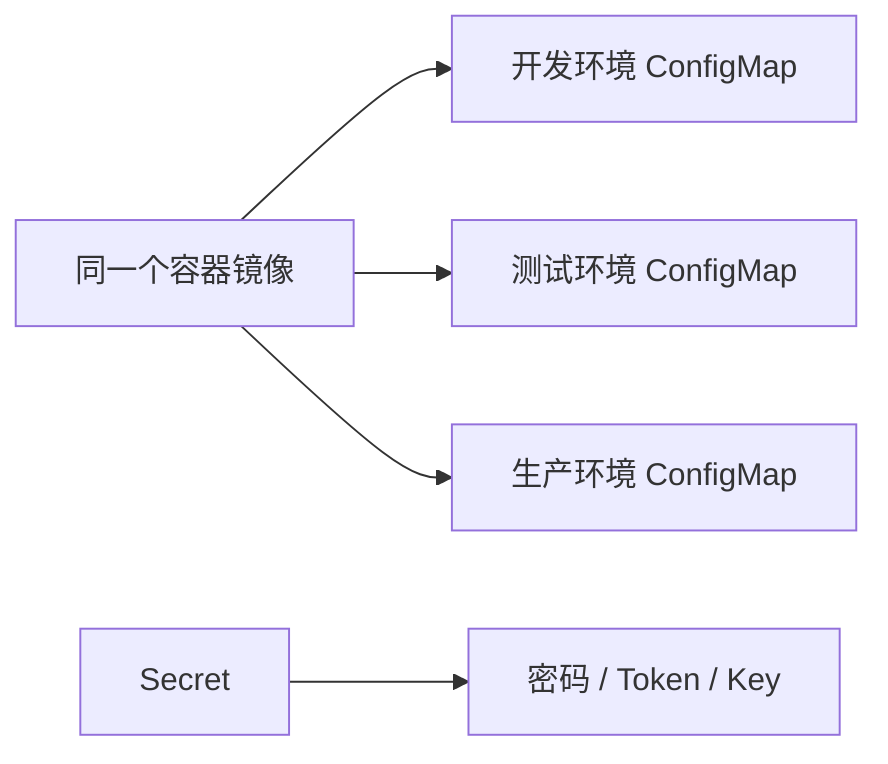
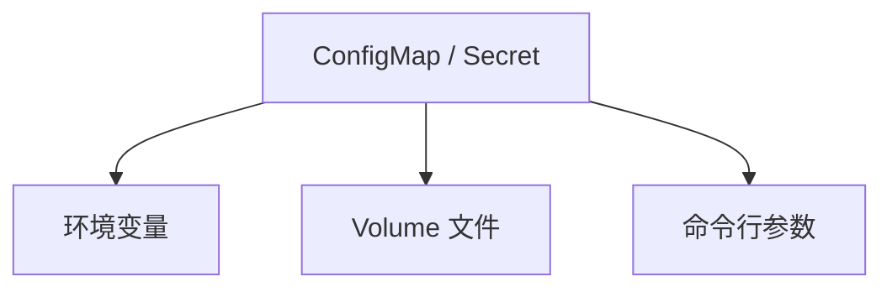

# 06｜ConfigMap 与 Secret：让镜像和环境配置分离

[← 上一章](05-service.md) · [首页](../README.md) · [下一章：存储 →](07-storage.md)

## 思路



## 1. 创建 ConfigMap 和 Secret

```powershell
kubectl apply -f manifests/04-config/app-config.yaml
kubectl apply -f manifests/04-config/app-secret.yaml
kubectl apply -f manifests/04-config/config-demo-pod.yaml
```

查看：

```powershell
kubectl get configmap app-config -o yaml
kubectl get secret app-secret -o yaml
kubectl exec config-demo -- env | Select-String 'APP_|DB_'
```

## 2. 文件挂载与环境变量

ConfigMap / Secret 常见注入方式：



环境变量方式通常需要重建 Pod 才读取新值；Volume 文件更新可能会延迟同步，但应用本身还需要支持重新读取。

## 3. Secret 不是加密保险箱

Secret 默认只是 Base64 编码；是否静态加密取决于集群配置。不要把真实生产密码提交到 GitHub。

解码实验值：

```powershell
$encoded = kubectl get secret app-secret -o jsonpath='{.data.DB_PASSWORD}'
[Text.Encoding]::UTF8.GetString([Convert]::FromBase64String($encoded))
```

## Dashboard 检查

- `Config and Storage → Config Maps`
- `Config and Storage → Secrets`
- Pod 的 Environment 与 Volumes

## 本章验收

```powershell
kubectl logs config-demo
kubectl exec config-demo -- cat /config/app.properties
```


## 生命周期检查：清理与重复

本章创建的 ConfigMap、Secret 与示例 Pod 应执行“创建 → 状态验证 → 修改/观察 → 恢复 → 删除 → 确认删除 → 再创建”两轮。更新 ConfigMap/Secret 后，环境变量注入的 Pod 通常需要重建；对挂载文件需确认同步延迟。不要把实际密码写进 Git。

从项目根目录、确认当前 Context 为 `minikube` 且实验对象归本章所有后，使用下列清理样板：

```powershell
kubectl config current-context
kubectl delete -f manifests/04-config/ --ignore-not-found --wait=true
kubectl apply -f manifests/04-config/
# 按本章上文执行状态检查及业务验证，再次运行同样的清理命令
```

**注意：**这只是清单对应资源的删除/重建示例，不代表完成了全章集成测试。若清单依赖其他章节的资源，应先检查依赖；对集群外进程、动态创建的 PVC/Job/Pod、以及同 Namespace 的共享对象，应逐项检查归属和残留。请参阅 [生命周期审计](21-lifecycle-audit-report.md)，其中所有尚未实际运行的章节仍标记为 PARTIAL。
