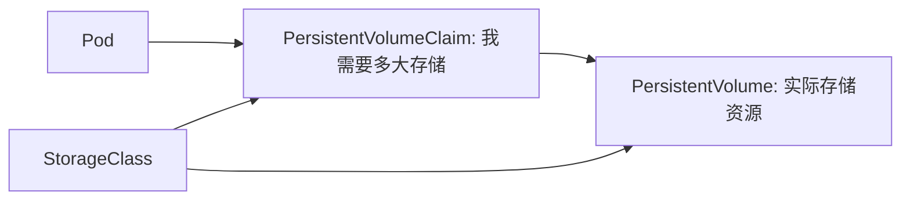
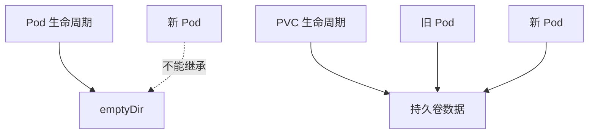

# 07｜Volume、PersistentVolume 与 PersistentVolumeClaim

[← 上一章](06-configmap-secret.md) · [首页](../README.md) · [下一章：健康检查 →](08-probes.md)

## 1. 三层关系



- Volume：Pod 内可用的存储挂载概念
- PVC：应用提出存储需求
- PV：集群提供的存储资源
- StorageClass：动态创建存储的模板

## 2. 查看 Minikube 存储能力

```powershell
kubectl get storageclass
kubectl get pv
kubectl get pvc
```

## 3. 创建 PVC 与 Pod

```powershell
kubectl apply -f manifests/05-storage/pvc.yaml
kubectl apply -f manifests/05-storage/pvc-demo-pod.yaml
kubectl get pvc,pv
```

写入文件：

```powershell
kubectl exec pvc-demo -- sh -c "date >> /data/history.txt"
kubectl exec pvc-demo -- cat /data/history.txt
```

删除并重建 Pod：

```powershell
kubectl delete pod pvc-demo
kubectl apply -f manifests/05-storage/pvc-demo-pod.yaml
kubectl exec pvc-demo -- cat /data/history.txt
```

数据仍在，说明生命周期不再绑定到单个 Pod。

## 4. emptyDir 对比



## Dashboard 检查

查看 PVC 的 `Status=Bound`、容量、StorageClass，再打开 Pod 查看挂载路径 `/data`。

## 本章验收

Pod 被删除重建后，`history.txt` 内容仍然存在。


## 生命周期检查：清理与重复

本章创建的 演示 Pod 应执行“创建 → 状态验证 → 修改/观察 → 恢复 → 删除 → 确认删除 → 再创建”两轮。先删除 Pod，再视数据保留要求决定是否删除 PVC。PVC 或 PV 的清理不可用本节的通用命令替代。

从项目根目录、确认当前 Context 为 `minikube` 且实验对象归本章所有后，使用下列清理样板：

```powershell
kubectl config current-context
kubectl delete -f manifests/05-storage/pvc-demo-pod.yaml --ignore-not-found --wait=true
kubectl apply -f manifests/05-storage/pvc-demo-pod.yaml
# 按本章上文执行状态检查及业务验证，再次运行同样的清理命令
```

**注意：**这只是清单对应资源的删除/重建示例，不代表完成了全章集成测试。若清单依赖其他章节的资源，应先检查依赖；对集群外进程、动态创建的 PVC/Job/Pod、以及同 Namespace 的共享对象，应逐项检查归属和残留。请参阅 [生命周期审计](21-lifecycle-audit-report.md)，其中所有尚未实际运行的章节仍标记为 PARTIAL。
