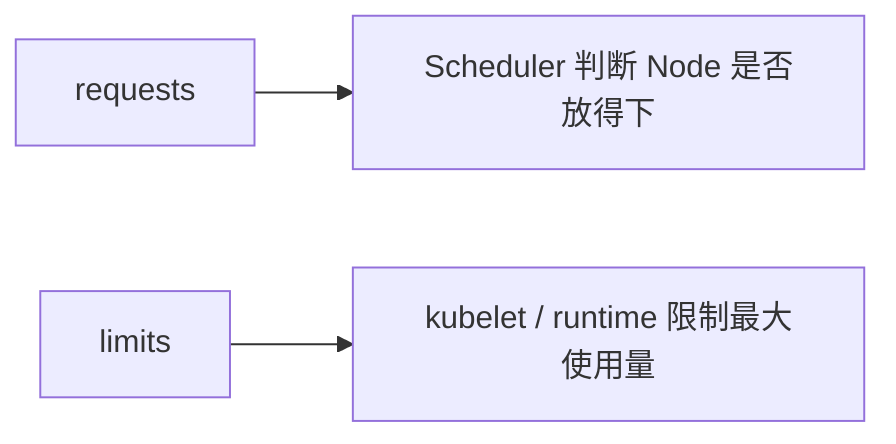
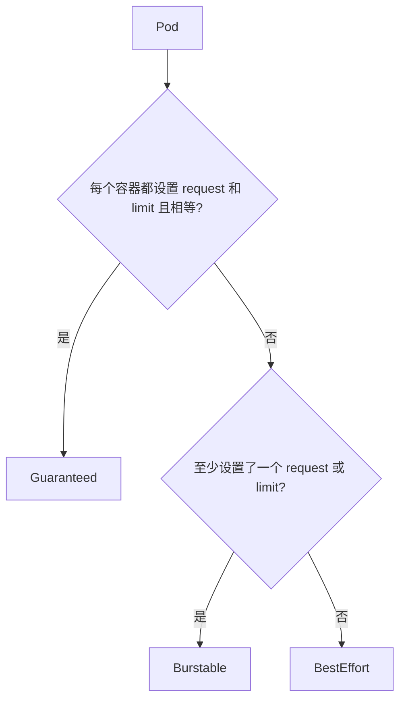

# 09｜CPU、内存 Requests / Limits 与 QoS

[← 上一章](08-probes.md) · [首页](../README.md) · [下一章：HPA →](10-hpa.md)

## 1. 调度与限制



- CPU request：调度时保留的计算能力
- CPU limit：允许使用的上限，超过时可能被节流
- Memory request：调度参考
- Memory limit：超过时容器可能 OOMKilled

## 2. 创建资源实验

```powershell
kubectl apply -f manifests/07-resources/resource-demo.yaml
kubectl get pod resource-demo
kubectl describe pod resource-demo
kubectl top pod resource-demo
kubectl top nodes
```

如 `kubectl top` 暂时无数据：

```powershell
minikube addons enable metrics-server
kubectl get pods -n kube-system | Select-String metrics
```

## 3. QoS 类别



查看 QoS：

```powershell
kubectl get pod resource-demo -o jsonpath='{.status.qosClass}'
```

## Dashboard / Headlamp 检查

观察 Pod CPU、内存指标和资源配置。指标出现通常需要等待几十秒。

## 本章验收

能区分“调度依据”和“运行上限”，并理解内存 limit 不是温和限速，而可能导致 OOMKill。


## 生命周期检查：清理与重复

本章创建的 资源限制演示 应执行“创建 → 状态验证 → 修改/观察 → 恢复 → 删除 → 确认删除 → 再创建”两轮。CPU 超限通常表现为节流；内存越限可能 OOMKilled，不能把两者混为一谈。

从项目根目录、确认当前 Context 为 `minikube` 且实验对象归本章所有后，使用下列清理样板：

```powershell
kubectl config current-context
kubectl delete -f manifests/07-resources/resource-demo.yaml --ignore-not-found --wait=true
kubectl apply -f manifests/07-resources/resource-demo.yaml
# 按本章上文执行状态检查及业务验证，再次运行同样的清理命令
```

**注意：**这只是清单对应资源的删除/重建示例，不代表完成了全章集成测试。若清单依赖其他章节的资源，应先检查依赖；对集群外进程、动态创建的 PVC/Job/Pod、以及同 Namespace 的共享对象，应逐项检查归属和残留。请参阅 [生命周期审计](21-lifecycle-audit-report.md)，其中所有尚未实际运行的章节仍标记为 PARTIAL。
