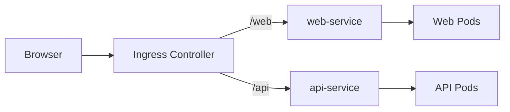
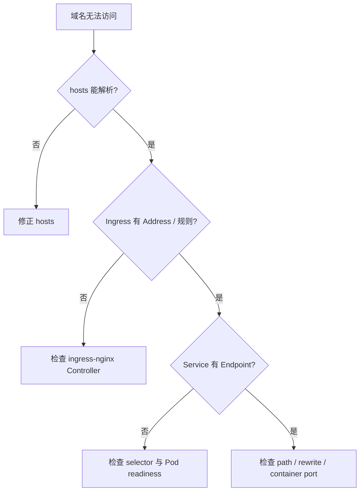

# 11｜Ingress：用域名和路径统一访问多个 Service

[← 上一章](10-hpa.md) · [首页](../README.md) · [下一章：RBAC →](12-rbac.md)

## 网络层次



Ingress 对象只是规则，真正执行规则的是 Ingress Controller。

## 1. 启用插件

```powershell
minikube addons enable ingress
kubectl get pods -n ingress-nginx
```

## 2. 应用示例

```powershell
kubectl apply -f manifests/09-ingress/
kubectl get ingress
kubectl describe ingress learning-ingress
```

## 3. Windows 访问方式

获取 IP：

```powershell
minikube ip
```

管理员权限编辑：

```text
C:\Windows\System32\drivers\etc\hosts
```

追加：

```text
<MINIKUBE_IP> learning.local
```

访问：

```text
http://learning.local/web
http://learning.local/api
```

Docker driver 在部分 Windows 网络环境下可能无法直接访问 Minikube IP，可使用：

```powershell
minikube tunnel
```

或者使用端口转发验证 Service。

## 4. 排错链路



## Dashboard 检查

查看 Ingress 的 Host、Path、Backend Service 与 Events。

## 本章验收

两个 URL 分别进入不同后端服务。


## 生命周期检查：清理与重复

本章创建的 Ingress 演示 应执行“创建 → 状态验证 → 修改/观察 → 恢复 → 删除 → 确认删除 → 再创建”两轮。先确认后端 Service/Pod 是否为本章创建的，再决定清理。Windows hosts 条目和 tunnel 进程属于集群外残留，需要手工恢复。

从项目根目录、确认当前 Context 为 `minikube` 且实验对象归本章所有后，使用下列清理样板：

```powershell
kubectl config current-context
kubectl delete -f manifests/09-ingress/ --ignore-not-found --wait=true
kubectl apply -f manifests/09-ingress/
# 按本章上文执行状态检查及业务验证，再次运行同样的清理命令
```

**注意：**这只是清单对应资源的删除/重建示例，不代表完成了全章集成测试。若清单依赖其他章节的资源，应先检查依赖；对集群外进程、动态创建的 PVC/Job/Pod、以及同 Namespace 的共享对象，应逐项检查归属和残留。请参阅 [生命周期审计](21-lifecycle-audit-report.md)，其中所有尚未实际运行的章节仍标记为 PARTIAL。
