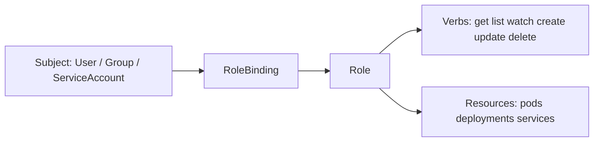
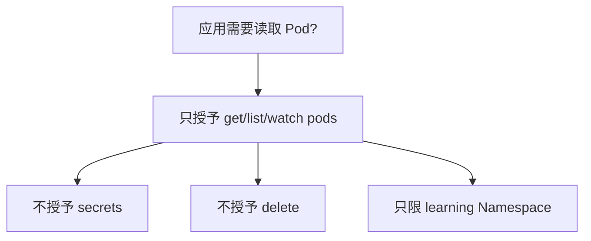

# 12｜ServiceAccount 与 RBAC：谁可以对什么做什么

[← 上一章](11-ingress.md) · [首页](../README.md) · [下一章：Job 与 CronJob →](13-job-cronjob.md)

## 权限模型



- Role：某个 Namespace 内的权限规则
- ClusterRole：集群范围或可复用的权限规则
- RoleBinding：把 Role/ClusterRole 绑定到主体
- ClusterRoleBinding：在整个集群绑定

## 创建只读 ServiceAccount

```powershell
kubectl apply -f manifests/10-rbac/pod-reader.yaml
```

验证权限：

```powershell
kubectl auth can-i list pods --as=system:serviceaccount:learning:pod-reader -n learning
kubectl auth can-i delete pods --as=system:serviceaccount:learning:pod-reader -n learning
kubectl auth can-i list secrets --as=system:serviceaccount:learning:pod-reader -n learning
```

期待：

```text
yes
no
no
```

## 最小权限原则



## Dashboard 管理员示例的风险

本地学习有时会创建 `cluster-admin` ServiceAccount 登录 UI，但它拥有近乎完全控制权。只可用于个人临时实验，完成后立即删除。

## 本章验收

能用 `kubectl auth can-i` 证明“允许读取 Pod，但不能删除 Pod 和读取 Secret”。


## 生命周期检查：清理与重复

本章创建的 RBAC 示例 应执行“创建 → 状态验证 → 修改/观察 → 恢复 → 删除 → 确认删除 → 再创建”两轮。分别验证允许读取和拒绝删除，不能仅凭 Role 存在断言权限生效。

从项目根目录、确认当前 Context 为 `minikube` 且实验对象归本章所有后，使用下列清理样板：

```powershell
kubectl config current-context
kubectl delete -f manifests/10-rbac/pod-reader.yaml --ignore-not-found --wait=true
kubectl apply -f manifests/10-rbac/pod-reader.yaml
# 按本章上文执行状态检查及业务验证，再次运行同样的清理命令
```

**注意：**这只是清单对应资源的删除/重建示例，不代表完成了全章集成测试。若清单依赖其他章节的资源，应先检查依赖；对集群外进程、动态创建的 PVC/Job/Pod、以及同 Namespace 的共享对象，应逐项检查归属和残留。请参阅 [生命周期审计](21-lifecycle-audit-report.md)，其中所有尚未实际运行的章节仍标记为 PARTIAL。
