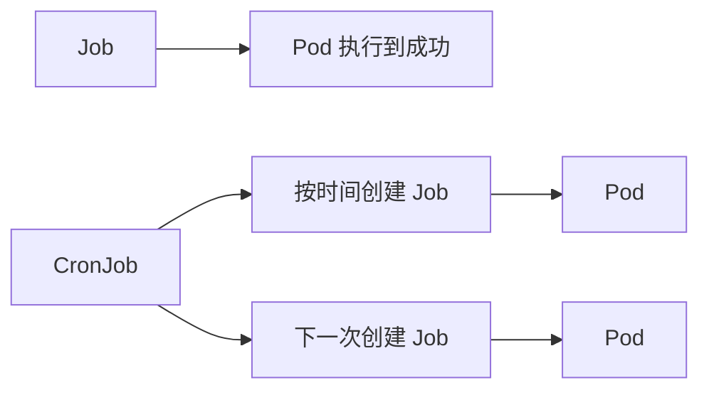

# 13｜Job 与 CronJob：一次性任务和定时任务

[← 上一章](12-rbac.md) · [首页](../README.md) · [下一章：StatefulSet →](14-statefulset.md)

## 概念



Deployment 希望 Pod 长期运行；Job 希望任务成功完成后结束。

## 创建

```powershell
kubectl apply -f manifests/11-jobs/job.yaml
kubectl apply -f manifests/11-jobs/cronjob.yaml
kubectl get jobs,cronjobs,pods
```

查看日志：

```powershell
kubectl logs job/pi
kubectl get jobs -w
```

手动触发 CronJob：

```powershell
kubectl create job --from=cronjob/hello-cron hello-now
kubectl logs job/hello-now
```

## 并发策略

| concurrencyPolicy | 含义 |
|---|---|
| Allow | 允许上一次未结束时再次运行 |
| Forbid | 上一次未结束则跳过 |
| Replace | 用新任务替换旧任务 |

## Dashboard 检查

查看 Job 的 Completion、Pod Logs、CronJob Schedule 与最近执行时间。

## 本章验收

`pi` Job 显示 `Complete`，手动触发的 `hello-now` 有日志输出。


## 生命周期检查：清理与重复

本章创建的 Job/CronJob 示例 应执行“创建 → 状态验证 → 修改/观察 → 恢复 → 删除 → 确认删除 → 再创建”两轮。第二轮手动触发 Job 时不能复用旧名称 hello-now；删除先前 Job 或改用新的唯一名称。

从项目根目录、确认当前 Context 为 `minikube` 且实验对象归本章所有后，使用下列清理样板：

```powershell
kubectl config current-context
kubectl delete -f manifests/11-jobs/ --ignore-not-found --wait=true
kubectl apply -f manifests/11-jobs/
# 按本章上文执行状态检查及业务验证，再次运行同样的清理命令
```

**注意：**这只是清单对应资源的删除/重建示例，不代表完成了全章集成测试。若清单依赖其他章节的资源，应先检查依赖；对集群外进程、动态创建的 PVC/Job/Pod、以及同 Namespace 的共享对象，应逐项检查归属和残留。请参阅 [生命周期审计](21-lifecycle-audit-report.md)，其中所有尚未实际运行的章节仍标记为 PARTIAL。
