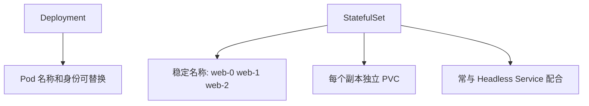
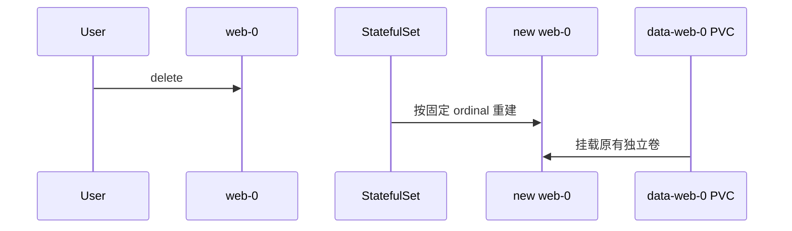

# 14｜StatefulSet：稳定身份、顺序与独立存储

[← 上一章](13-job-cronjob.md) · [首页](../README.md) · [下一章：DaemonSet →](15-daemonset.md)

## Deployment 与 StatefulSet



适合数据库、消息系统等需要稳定网络身份或独立存储的应用。但使用 StatefulSet 不等于自动获得数据库高可用，应用本身仍需支持复制、选主和恢复。

## 创建示例

```powershell
kubectl apply -f manifests/12-statefulset/
kubectl get statefulset,pods,pvc
```

查看稳定 DNS：

```text
web-0.nginx.learning.svc.cluster.local
web-1.nginx.learning.svc.cluster.local
```

删除 `web-0`：

```powershell
kubectl delete pod web-0
kubectl get pods -w
```

新 Pod 仍叫 `web-0`，并重新挂载自己的 PVC。



## Dashboard 检查

观察 StatefulSet 副本、Pod ordinal、PVC 名称和 Events。

## 本章验收

删除 `web-0` 后，名称与 PVC 绑定关系保持稳定。


## 生命周期检查：清理与重复

本章创建的 StatefulSet 示例 应执行“创建 → 状态验证 → 修改/观察 → 恢复 → 删除 → 确认删除 → 再创建”两轮。删除 StatefulSet 通常不会自动删除 volumeClaimTemplates 创建的 PVC；删除数据前必须明确是否需要保留。

从项目根目录、确认当前 Context 为 `minikube` 且实验对象归本章所有后，使用下列清理样板：

```powershell
kubectl config current-context
kubectl delete -f manifests/12-statefulset/ --ignore-not-found --wait=true
kubectl apply -f manifests/12-statefulset/
# 按本章上文执行状态检查及业务验证，再次运行同样的清理命令
```

**注意：**这只是清单对应资源的删除/重建示例，不代表完成了全章集成测试。若清单依赖其他章节的资源，应先检查依赖；对集群外进程、动态创建的 PVC/Job/Pod、以及同 Namespace 的共享对象，应逐项检查归属和残留。请参阅 [生命周期审计](21-lifecycle-audit-report.md)，其中所有尚未实际运行的章节仍标记为 PARTIAL。
