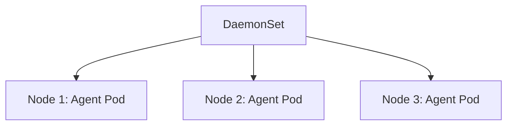

# 15｜DaemonSet：让每个 Node 都运行一个 Pod

[← 上一章](14-statefulset.md) · [首页](../README.md) · [下一章：NetworkPolicy →](16-networkpolicy.md)

## 使用场景

- 日志采集代理
- 节点监控 Agent
- 网络插件
- 安全 Agent



## 创建

```powershell
kubectl apply -f manifests/13-daemonset/node-agent.yaml
kubectl get daemonset
kubectl get pods -l app=node-agent -o wide
```

单节点 Minikube 通常只会看到一个 Pod。

## 多节点扩展实验

可另建一个多节点 profile：

```powershell
minikube start -p multinode --nodes=3 --driver=docker --cpus=2 --memory=3072
kubectl config use-context multinode
kubectl create namespace learning
kubectl apply -n learning -f manifests/13-daemonset/node-agent.yaml
kubectl get pods -n learning -o wide
```

实验后切回：

```powershell
kubectl config use-context minikube
```

## 与 Deployment 区别

| Deployment | DaemonSet |
|---|---|
| 目标是指定副本数 | 目标是符合条件的每个 Node 一个 Pod |
| 适合业务应用 | 适合节点级 Agent |

## 本章验收

DaemonSet 的 `DESIRED` 数量应与符合调度条件的 Node 数一致。


## 生命周期检查：清理与重复

本章创建的 DaemonSet 示例 应执行“创建 → 状态验证 → 修改/观察 → 恢复 → 删除 → 确认删除 → 再创建”两轮。多 Node Profile 应用完成后需单独确认，再使用 minikube delete -p multinode 清理；不要删除其他 Profile。

从项目根目录、确认当前 Context 为 `minikube` 且实验对象归本章所有后，使用下列清理样板：

```powershell
kubectl config current-context
kubectl delete -f manifests/13-daemonset/node-agent.yaml --ignore-not-found --wait=true
kubectl apply -f manifests/13-daemonset/node-agent.yaml
# 按本章上文执行状态检查及业务验证，再次运行同样的清理命令
```

**注意：**这只是清单对应资源的删除/重建示例，不代表完成了全章集成测试。若清单依赖其他章节的资源，应先检查依赖；对集群外进程、动态创建的 PVC/Job/Pod、以及同 Namespace 的共享对象，应逐项检查归属和残留。请参阅 [生命周期审计](21-lifecycle-audit-report.md)，其中所有尚未实际运行的章节仍标记为 PARTIAL。
